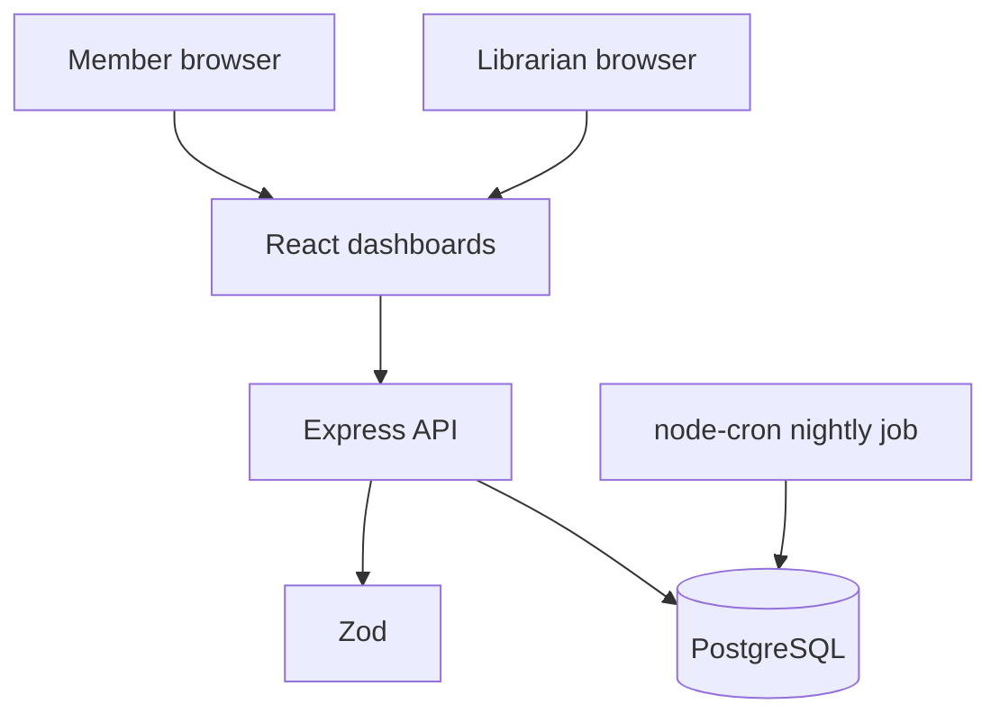

# BookNook

BookNook is a lending desk for a single branch library. Members search the catalogue, borrow a copy, and join a queue when every copy is out. Librarians see overdue loans, holds that are ready for pickup, and the fines those loans have earned.

Due dates and fines are calculated in Postgres. A nightly Node job and the return desk both call that same SQL, so the number on the dashboard cannot drift from the number that gets stored.

## Features

- Catalogue search across title, author, and category, using a `tsvector` column and a GIN index. Title matches rank above author matches, which rank above category matches. Renaming a category refreshes the books in it.
- Borrow, return, and reservation workflows. A reservation is for the title. The physical thing that leaves the building is a copy.
- Due dates are `borrowed_on + loan_days`, read from a single `library_policy` row. Overdue fines are `min(days late × daily rate, cap)`, from the `overdue_fine_cents` SQL function.
- A scheduled job (02:15 UTC, overridable with `MAINTENANCE_CRON`) refreshes fines on open overdue loans and expires holds that were not picked up. The desk can run the same job immediately.
- Separate React dashboards for members and librarians. The server checks the role. Hiding a button is not the access check.
- Zod validates request bodies, query strings, and ids. Versioned SQL migrations live in `server/migrations`. Supertest covers the lending rules against a real Postgres database.

## Lending rules

The defaults live in `library_policy` and are shown on both dashboards.

- A loan is 14 days. The due date itself is free. The next day is one day's fine, at $0.25, capped at $10.
- A member may have five open loans, and only one open loan of a given title.
- Unpaid fines of $5 or more block new loans and new reservations. Paying or waiving the fine lifts the block. A fine that has been paid or waived is not recalculated.
- If a copy is on the shelf, the member borrows it. Reservations are only for titles with nothing available.
- When a copy comes back, it is held for the oldest waiting reservation. The member has 3 days to pick it up. The nightly job expires a missed hold and offers the copy to the next person. Cancelling a ready hold does the same thing.
- A ready hold still counts toward the loan limit. A member who is already at five loans has until the hold expires to return something and pick it up.

## Architecture



Search is not a `LIKE` scan. `books.search_vector` is maintained by triggers: title at weight A, author at weight B, category name at weight C. The GIN index is `books_search_gin`. Queries use `websearch_to_tsquery`, so a search for "histories" still finds "history".

Passwords are bcrypt. The seed migration hashes the demo passwords with `pgcrypto`, and the API checks them with `bcryptjs`. Sign-in returns a JWT that lasts eight hours.

## Folder structure

```
server/
  migrations/          001 schema, 002 search, 003 seed
  src/routes/          HTTP handlers
  src/services/        lending, fines, search, dashboards
  src/jobs/nightly.js  the work the cron job runs
  src/scheduler.js     node-cron schedule
  test/                Supertest against booknook_test
client/
  src/pages/           login, catalogue, member dashboard, desk
docker-compose.yml     Postgres 16, plus the booknook_test database
```

## Running locally

Node 20 or newer, and Docker.

```bash
docker compose up -d
cp .env.example .env
npm install
npm run migrate
npm run dev
```

The API listens on port 4000 and applies any pending migrations when it starts. The Vite dev server listens on port 5173 and proxies `/api` to the API. Open http://localhost:5173.

`npm start` serves the built client from Express after `npm run build`. In development, use `npm run dev` so the client has hot reload.

Demo accounts, also printed on the sign-in page:

| Who | Email | Password |
| --- | --- | --- |
| Ada Okonkwo, librarian | ada@booknook.local | library123 |
| Sam Patel, member | sam@booknook.local | member123 |
| Noah Brooks, member | noah@booknook.local | member123 |

Sam has Kindred out, A Brief History of Time six days overdue, and is waiting on The Left Hand of Darkness, which Noah has. That is enough to see both dashboards without clicking through a setup.

To wipe the Docker database and seed it again:

```bash
docker compose down -v
docker compose up -d
npm run migrate
```

Postgres has to be reachable at `DATABASE_URL`. The compose file publishes `localhost:5432` with user `booknook`, password `booknook`, database `booknook`. None of those values are production credentials. Set `JWT_SECRET` before running with `NODE_ENV=production`. The process refuses to boot in production with the dev default.

## Tests

```bash
npm test
npm run lint
npm run build
```

Tests use `booknook_test`, created by `docker/init-test-db.sql` on a fresh compose volume, or by the test preload if the role can create databases. They migrate, truncate, and exercise search, loan limits, fines, the hold queue, and role checks. They do not mock SQL.

## Design decisions

Copies and titles are different rows. A member wants the next free copy of a title, not a particular barcode, so reservations point at `books` and loans point at `copies`. One open loan per copy is a partial unique index, not only an application check.

Fines live in one immutable SQL function. The return transaction, the nightly job, and the overdue list all pass in an as-of date. Callers cannot invent a second formula.

`library_policy` is a single row (`id` is a boolean primary key that must be true). Loan length and the fine rate are data, so a branch can change them without a code edit. The app reads the row inside the lending transaction.

The nightly job is `node-cron` in the API process, aimed at 02:15 UTC. The librarian button calls the same function, which is what the tests call too. There is no second implementation hiding behind the button.

Zod is the edge. Postgres constraints are the backstop: role checks, one active reservation per member per title, one open loan per copy, and a ready reservation that must name a copy and an expiry date.
